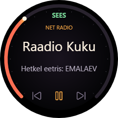
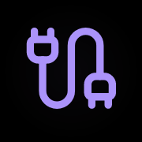

# Yamaha R-N301 · Loupedeck CT

Direct LAN control for a **Yamaha R-N301 receiver from a Loupedeck CT** on Windows. No Home Assistant token, cloud account or keyboard macros are used for receiver control.



Tested with one R-N301 and one Loupedeck CT. If you happen to own this unusually specific combination too, this may save you some work. Other Yamaha models and Loupedeck devices are not claimed to work.

| Power | Mute | Inputs | Media / FM |
|:---:|:---:|:---:|:---:|
|  |  |  |  |
| Sky Plus | Raadio 2 | Raadio Kuku (active) | Vikerraadio |
|  |  |  |  |
| Power Hit Radio | Raadio Elmar | NRJ | Star FM |
|  |  |  |  |

## Use

Open your **Yamaha** workspace in the Windows default profile. The reference layout assigns it to round button **3**; a manual installation can use any free button. Other application profiles keep their own controls. The CT has four touchscreen columns and three rows; see [the complete mapping](LAYOUT.md).

- Large wheel: volume in single steps, with immediate amber arc feedback. No duplicate volume number in the center.
- Wheel screen: source, large station name, and the song/program metadata supplied by the receiver. Lower left/right touch targets select previous/next; the center toggles playback.
- Upper-left dial: volume number, or `Mute`, `Off`, `Offline`; press to mute. Muting changes the arc to violet.
- Radio favorites: white Lucide icons. The active playing station has an amber glow and dot. Green power, amber mute, violet inputs and rose media retain separate functional colors.
- Physical left/right arrows: previous/next only while the Yamaha workspace is active. Elsewhere they send normal left/right arrow keys; their Fn actions are unchanged. If workspace detection fails, they fall back to normal arrows.

The volume ring is a **0–100 receiver control scale**, not a sound-pressure meter. Metadata availability and freshness depend on the selected source and radio stream. NET RADIO does not implement native Pause/Skip: stopping/resuming reselects the last favorite, and previous/next navigate the configured favorites.

Use this only on a trusted LAN. Yamaha's XML endpoint is plain HTTP without authentication; do not expose it to the internet. `MaxVolume` in the private settings can cap the receiver's volume control range.

## Requirements and local settings

Built and installed against Logi Plugin API 6.4.2.3414 and .NET 10.0.402 on Windows with a Loupedeck CT. Other models/versions are untested.

The private receiver configuration is stored at:

```text
%LOCALAPPDATA%\YamahaDirect\settings.json
```

Start from [settings.example.json](settings.example.json) only for a new installation. Keep the actual address and device identity in local settings, not in a public profile. The plugin verifies model and device ID and uses SSDP to rediscover the same receiver if its address changes; it must not choose the RX-V4A.

## Install the plugin (new users)

1. Export your current Loupedeck profiles and keep a backup of `%LOCALAPPDATA%\Logi\LogiPluginService` before making changes.
2. Download `YamahaDirect.lplug4` from [Releases](https://github.com/rihokirss/yamaha-loupedeck/releases). Open it using Loupedeck's plugin installer. Restart the Logi/Loupedeck service if the plugin does not appear. The release package does **not** include anyone's personal profile or receiver settings.
3. Copy `settings.example.json` to `%LOCALAPPDATA%\YamahaDirect\settings.json`, filling in your receiver's IPv4 `Host` and exact `SystemId`. The `Model` must remain `R-N301`. Restart the service after editing settings. No HA token is needed.
4. In the Windows default profile, create a new workspace named **Yamaha**. Assign the plugin's actions using [LAYOUT.md](LAYOUT.md). Choose **Yamaha · Hi-Fi** as its wheel template, volume adjustment **Yamaha Volume**, and actions **Eelmine**, **Esita / peata**, **Järgmine** in that order.
5. Assign a free round button to the new workspace. Start at a low volume and test power, mute and a single volume step first. Verify your existing workspaces still work.

To read the identity from a receiver at a known IP, this is a **read-only** request:

```powershell
$receiverHost = '<receiver IPv4>'
$body = '<YAMAHA_AV cmd="GET"><System><Config>GetParam</Config></System></YAMAHA_AV>'
[xml]$identity = (Invoke-WebRequest "http://$receiverHost/YamahaRemoteControl/ctrl" -Method Post -ContentType 'text/xml' -Body $body).Content
$identity.YAMAHA_AV.System.Config | Select-Object Model_Name, System_ID
```

Match that identity to the correct physical device. For a manually created workspace, set `WorkspaceId` in your private `settings.json` to that workspace's `name` from the exported profile's `ProfileInfo.json`, then restart the service. This makes contextual arrow routing and 2s/10s polling follow your workspace; no code rebuild is needed. The included ID is deterministic for the reference merge helper, not a receiver identifier. The dial and touchscreen actions work without contextual-arrow assignment.

Radio buttons use the eight station names in `settings.json`. They must already exist in your YCast **My Stations → Bookmarks** menu, with matching names. This plugin does not install/configure YCast or provide radio streams.

## Choose your own radio stations

### Select a station while listening

Tap its touchscreen button. Alternatively, turn the **lower-left dial**, press the physical **left/right arrows**, or touch the wheel's lower **previous/next** symbols to step through your configured favorites. These controls navigate radio favorites when the active input is NET RADIO. To choose a saved **FM** station, open **Meedia / FM** and tap a receiver preset.

### Change the eight touchscreen favorites

There is currently **no station-configuration picker in Loupedeck** and no built-in radio catalogue. The eight buttons are configured by name:

1. First add the stations you want to your existing YCast **My Stations → Bookmarks** list. Confirm each station plays on the receiver.
2. Stop the Logi/Loupedeck service before editing its settings. If Options+ automatically restarts that service, stop its background agent too. The running plugin periodically saves settings, so editing the file while it is running can overwrite your changes.
3. Back up `%LOCALAPPDATA%\YamahaDirect\settings.json`.
4. Edit only its `Stations` array, keeping **eight station names** that match your YCast bookmarks. Keep `Host`, `SystemId` and the other settings intact. For example:

   ```json
   "Stations": [
     "Sky Plus", "Raadio 2", "Raadio Kuku", "Vikerraadio",
     "Power Hit Radio", "Raadio Elmar", "NRJ", "Star FM"
   ]
   ```

5. Start the service again and reopen the Yamaha workspace. The array order maps to the touchscreen from **left to right**: the first four names form the second row, and the last four form the third row. The same order is used by previous/next navigation.

The names above are examples, not a required station list. Put other existing bookmark names in the same slots to use your own choices. Stream URLs belong in YCast, **not** in this plugin's `Stations` array. FM presets are read from the receiver rather than from this array.

## Build from source

Editable C# sources are in `Yamaha.Core/` and `Yamaha.Loupedeck/`; editable Lucide SVG geometry and its license are in `icons/`. The vector/raster compositions and colors are in `Yamaha.Loupedeck/Artwork.cs`. The full 240px wheel is a custom `WheelToolYamahaNowPlaying`, not a stock icon template.

```powershell
dotnet build .\Yamaha.Loupedeck -c Release
dotnet run --project .\Yamaha.Tools -c Release -- test
dotnet run --project .\Yamaha.Preview -c Release -- .
```

If the API is installed elsewhere, set MSBuild property `PluginApiDir` to its directory. The build references the installed SDK; it does not bundle Logi's API DLLs.

### Optional: automated workspace merge for the original two-workspace setup

This helper targets the original author's existing Windows profile and arrow-action IDs. It is **not a universal profile installer** and will refuse unexpected mappings. New users should use the manual setup above.

```powershell
.\tools\install.ps1 -ReceiverHost '<receiver IPv4>' -SystemId '<receiver System_ID>'
```

The installer backs up the System profile, local plugins, Yamaha settings and Loupedeck settings before editing anything; it also preserves the original setup's separately backed-up application profile. It stages from the current profile, refuses an unexpected workspace layout or occupied button 3/arrow mappings, and checks that unrelated settings are identical. It then briefly stops/restarts the Loupedeck service and configuration UI.

Do not run it blindly against another user's profile. To adapt the merge helper, inspect your profile's existing arrow actions and choose the desired workspace button in `tools/prepare_profile.py`, after backing up that profile.

## Recovery and exports

Every installation creates `backups/yamaha-install-<timestamp>/`. The original pre-Yamaha snapshot is also retained in `backups/yamaha-pre-install-20261024-212441/`. These are private and ignored by Git.

Run `python .\tools\export_installed.py` after building/installing to create:

- `dist/YamahaDirect.lplug4`: the plugin package, without private receiver settings.
- `dist/Yamaha-installed.LP4`: the current complete System profile recovery export. It includes your two original workspaces, so treat it as personal data.
- `.local/SHA256SUMS.txt`: checksums for both archives.

To recover this machine, back up the current configuration again, install/import the plugin first, then import the LP4 using Loupedeck's profile import UI and restore the private Yamaha settings if necessary. Check the imported profile before selecting it. For full file-level rollback, stop Loupedeck and its service (including the Options+ watchdog), restore the matching `System`, `Plugins`, Yamaha settings and `LoupedeckSettings.ini` snapshot, then restart them. Do not overwrite newer application-profile changes with an old backup.

## Verification and limitations

See [TESTING.md](TESTING.md) for automated and receiver tests, plus the checks that still need active media or physical interaction. A read-only preservation audit is available:

```powershell
python .\tools\verify_install.py --baseline .\backups\yamaha-pre-install-20261024-212441
```

The plugin polls every two seconds on the Yamaha workspace, every ten seconds in the background. Knob targets are displayed immediately and then reconciled with receiver state. Rapid volume ticks combine into ordered requests at no more than five per second. Offline commands are discarded, not replayed on reconnect. Volume controls do not power on a standby receiver.

SERVER's full file browser is intentionally excluded. Spotify, AirPlay and SERVER transport behavior needs manual testing with real active playback. No audio listening test or sound-level calibration is claimed.

## Credits

Radio/source behavior was developed alongside the [R-N301 Home Assistant integration](https://github.com/rihokirss/homeasisstant-rn301), but this plugin talks directly to the receiver. Icons use [Lucide](https://lucide.dev/); their license is retained in [icons/LICENSE](icons/LICENSE). Yamaha, Loupedeck and Logitech are trademarks of their respective owners; this is an unofficial community project.
